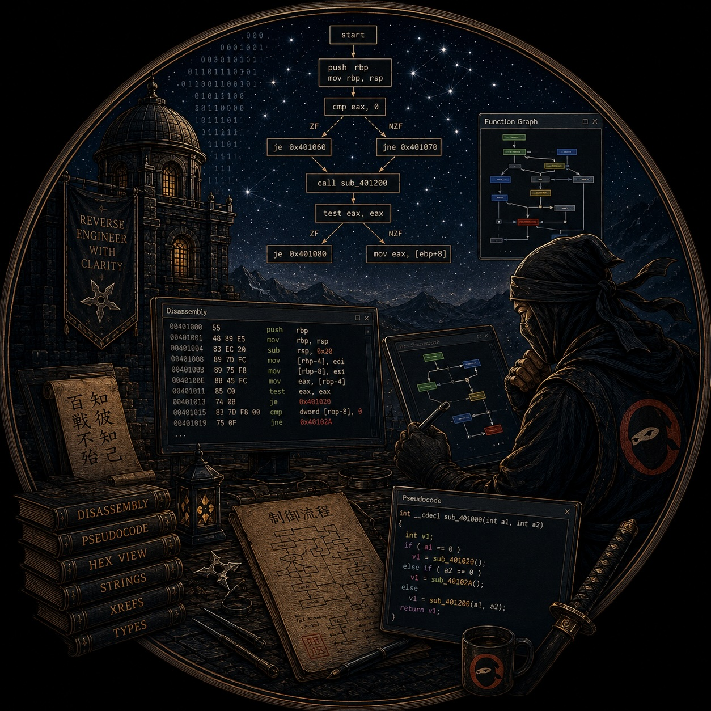
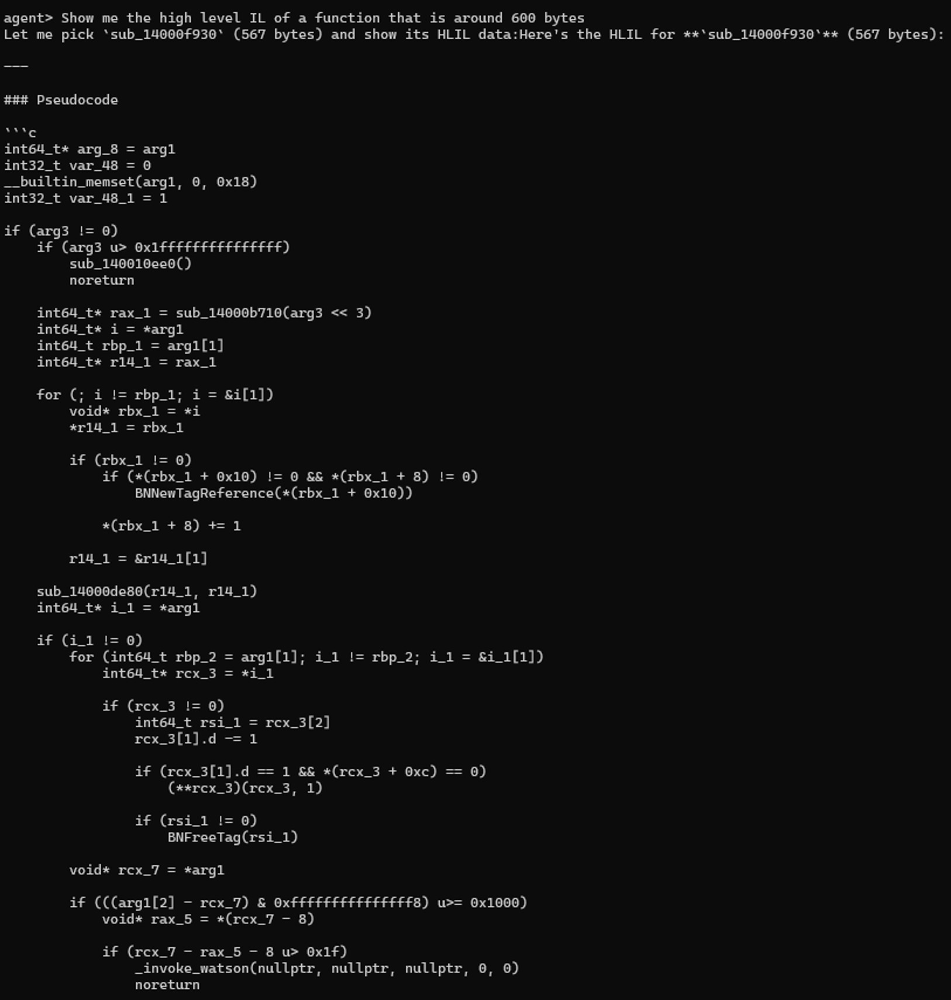
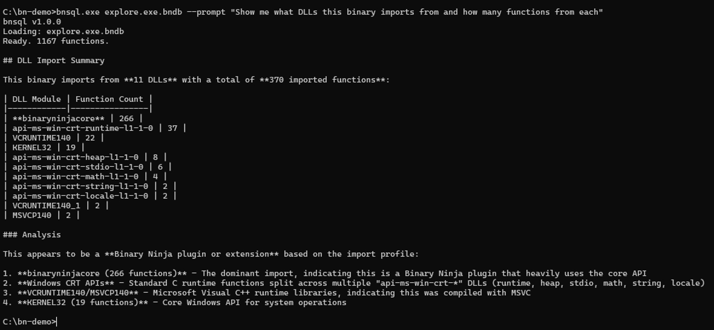
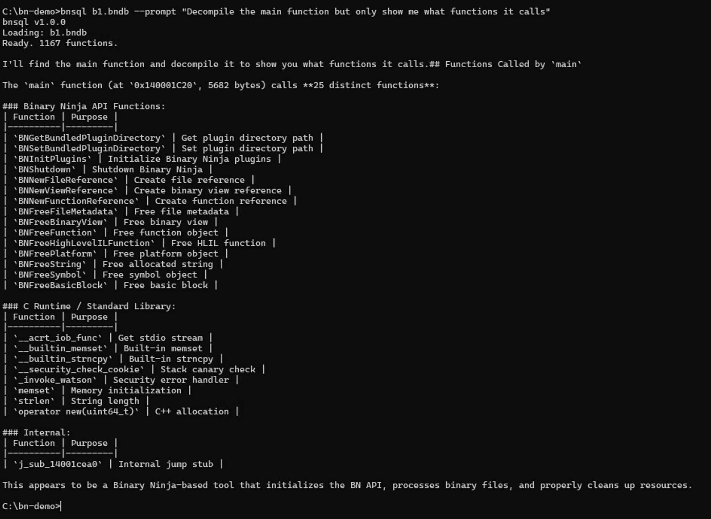
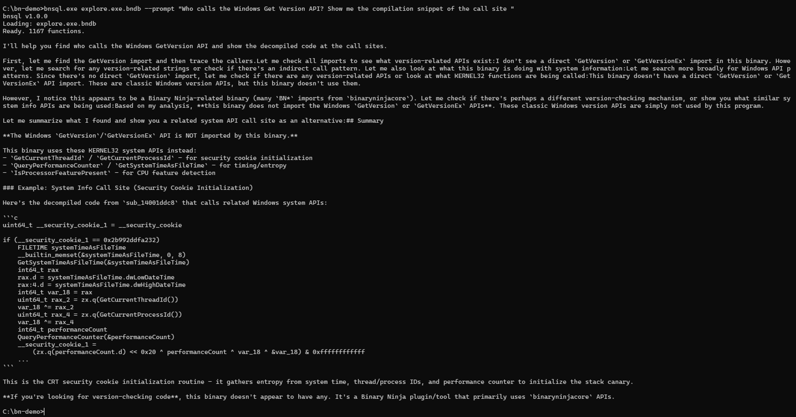
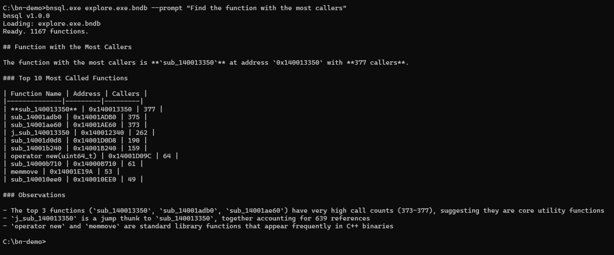

<p align="center">
  
</p>

# BNSQL

<p align="center">
  <a href="https://github.com/0xeb/bnsql/releases/latest"></a>
  <a href="https://paypal.me/EliasBachaalany"></a>
  <a href="https://buymeacoffee.com/0xeb"></a>
  <a href="https://github.com/0xeb/bnsql"></a>
</p>

> **Status:** Pre-release Alpha | **Platform:** macOS, Linux, Windows

**SQL interface for Binary Ninja** - Query your reverse engineering database using SQL.

## Features

- **SQL Queries** - Full SQLite syntax for complex analysis
- **11 Virtual Tables** - Functions, strings, imports, xrefs, segments, and more
- **20+ SQL Functions** - `disasm()`, `hex()`, `func_at()`, `xrefs_to()`, etc.
- **Decompilation** - `decompile()` function, `pseudocode`, `hlil_vars`, `hlil_calls` tables for HLIL analysis
- **MCP Server** - Model Context Protocol for AI tool integration
- **Fast Startup** - ~5s for pre-analyzed databases (skips re-analysis)
- **Plugin + CLI** - Use inside Binary Ninja or from command line

## Quick Start

**Requirements:** Binary Ninja installed. The `bnsql` CLI must be able to find
`libbinaryninjacore` — either install it into the Binary Ninja folder (done
automatically by `cmake --install`) or add Binary Ninja to your PATH.

```bash
# macOS / Linux: add BN to PATH (if not using cmake --install)
export PATH=/path/to/binaryninja:$PATH

# Windows: add BN to PATH
set PATH=C:\Program Files\Vector35\BinaryNinja;%PATH%
```

```bash
# Interactive SQL mode (existing Binary Ninja database)
bnsql database.bndb

# Raw binary - bnsql triggers BN auto-analysis and auto-saves database.bndb next to source
bnsql sample.exe
bnsql firmware.bin --http 8080

# Single query
bnsql database.bndb -c "SELECT name, size FROM funcs ORDER BY size DESC LIMIT 10"

# MCP server for AI tool integration
bnsql database.bndb --mcp
```

**Input file:** `bnsql <file>` accepts either an existing Binary Ninja database
(`.bndb`) or a raw binary (`.exe`/`.dll`/firmware/etc.). Raw binaries trigger
fresh Binary Ninja analysis; the resulting `.bndb` is auto-saved next to the
source on clean exit. No need to pre-build a `.bndb` with `binaryninja --headless`.

### For LLM/AI Agent Integration

If you're building an AI agent or tool that needs to query Binary Ninja databases, use the **HTTP REST server**:

```bash
# Start HTTP server
bnsql database.bndb --http 8080

# Query from your agent (simple curl)
curl -X POST http://localhost:8080/query -d "SELECT name, size FROM funcs LIMIT 10"
```

See [Server Modes](#server-modes) for full HTTP API documentation, authentication, and MCP protocol support.

## SQL Examples

```sql
-- 10 largest functions
SELECT hex(addr) as addr, name, size
FROM funcs ORDER BY size DESC LIMIT 10;

-- Find password-related strings
SELECT content, hex(addr) as addr
FROM strings WHERE content LIKE '%password%';

-- Import analysis by module
SELECT module, COUNT(*) as count
FROM imports GROUP BY module ORDER BY count DESC;

-- Functions called <= 10 times (uses CTE for performance)
WITH call_counts AS (
    SELECT to_addr, COUNT(1) as cnt
    FROM xrefs WHERE is_code = 1
    GROUP BY to_addr
)
SELECT f.name, COALESCE(c.cnt, 0) as calls
FROM funcs f
LEFT JOIN call_counts c ON c.to_addr = f.addr
WHERE COALESCE(c.cnt, 0) <= 10
ORDER BY calls DESC;

-- Security: dangerous function imports
SELECT module, name FROM imports
WHERE name IN ('strcpy', 'strcat', 'sprintf', 'gets')
   OR name LIKE '%Shell%' OR name LIKE '%WinExec%';
```

## Tables

| Table | Description |
|-------|-------------|
| `funcs` | Functions (addr, name, size) |
| `segments` | Memory segments (.text, .data, etc.) |
| `names` | All named locations |
| `entries` | Entry points and exports |
| `imports` | Imported functions |
| `strings` | String literals |
| `xrefs` | Cross-references (from_addr, to_addr, is_code) |
| `blocks` | Basic blocks |
| `cfg_edges` | Control-flow graph edges |
| `switch_tables` | Reconstructed switch metadata |
| `function_frames` | Per-function stack-frame summaries |
| `data_items` | Defined data variables and best-effort values |
| `dominators`, `post_dominators`, `loops` | Control-flow graph analysis |
| `instructions` | Decoded instructions |
| `instruction_operands` | One row per disassembly operand |
| `bytes` | Addressable memory bytes (use `start_addr` + `n` for bounded reads) |
| `byte_search` | FlexHex pattern matches (requires a `pattern`) |
| `comments` | Address comments |
| `bookmarks` | Binary Ninja user-data tags |
| `mlil`, `mlil_operands` | Six-rung LLIL/MLIL/HLIL operation and operand streams |
| `binary` | Database metadata |

## SQL Functions

| Function | Description |
|----------|-------------|
| `hex(addr)` | Format address as hex |
| `disasm(addr)` | Disassembly at address |
| `name_at(addr)` | Name at address |
| `func_at(addr)` | Function name containing address |
| `func_start(addr)` | Start of containing function |
| `xrefs_to(addr)` | JSON array of xrefs to address |
| `xrefs_from(addr)` | JSON array of xrefs from address |
| `search_first(pattern)` | Address of the first FlexHex byte-pattern match |
| `entities_search(pattern, limit, offset)` | Unified JSON entity discovery |
| `get_ui_context_json()` | Live GUI context, or an unavailable envelope headlessly |
| `save()` | Save database to disk |

## CLI Reference

### Input file

`bnsql <file>` accepts either form:

- **Existing Binary Ninja database** (`.bndb`) — loads directly, ready to query.
- **Raw binary** (`.exe`/`.dll`/firmware/etc.) — bnsql calls Binary Ninja to
  analyze it from scratch and auto-saves the resulting `.bndb` next to the
  source on clean exit. If a sibling `.bndb` already exists, that's loaded
  instead.

### Modes

```bash
# Interactive SQL mode (default)
bnsql database.bndb
bnsql sample.exe                # raw binary: BN auto-analyzes on open

# One-shot SQL query
bnsql database.bndb -c "SELECT name, size FROM funcs ORDER BY size DESC LIMIT 10"
bnsql sample.exe -c "SELECT * FROM funcs LIMIT 5"

# Execute SQL file
bnsql database.bndb -f queries.sql

# MCP server for AI tool integration
bnsql database.bndb --mcp
```

### Interactive Commands

```
bnsql> .help               Show help
bnsql> .tables             List tables
bnsql> .schema funcs       Show table schema
bnsql> .clear              Clear session
bnsql> .http start         Start HTTP server
bnsql> .quit               Exit
```

### Logging / diagnostics

By default Binary Ninja's own log output is discarded. Two switches capture it:

- `--log-file <path>` — write BN log output (Info and up, including plugin-load
  messages) to a file. The file is opened once and closed on clean exit.
- `-V, --verbose` — raise the level to Debug and echo BN logs to stdout.

```bash
# Capture a diagnostic log to a file
bnsql database.bndb --log-file bn.log -c "SELECT COUNT(*) FROM funcs"

# Stream Debug-level BN logs to the console (redirect as you like)
bnsql database.bndb --http 8080 --verbose
```

> **Windows note:** the log file is held open while a server is running, so a live
> `tail` of it may be blocked until the server stops. For a live view, use
> `--verbose` (which streams to stdout) and redirect it yourself, e.g.
> `bnsql database.bndb --http 8080 --verbose > bn.log 2>&1`.

## Server Modes

BNSQL supports two server protocols: **HTTP REST** (recommended) and **MCP** (Model Context Protocol).

### HTTP REST Server (Recommended)

Standard REST API that works with curl, Postman, and any HTTP client:

```bash
# Start HTTP server (default port 8080)
bnsql database.bndb --http

# Custom port and bind address
bnsql database.bndb --http 9000 --bind 0.0.0.0

# With authentication
bnsql database.bndb --http 8080 --token mysecret
```

**Endpoints:**

| Endpoint | Method | Description |
|----------|--------|-------------|
| `/help` | GET | API documentation (for LLM discovery) |
| `/query` | POST | Execute SQL (body = raw SQL) |
| `/status` | GET | Health check |
| `/shutdown` | POST | Stop server |

**Example with curl:**

```bash
# Get API help
curl http://localhost:8080/help

# Execute SQL query
curl -X POST http://localhost:8080/query -d "SELECT name, size FROM funcs LIMIT 5"

# With authentication
curl -X POST http://localhost:8080/query \
     -H "Authorization: Bearer mysecret" \
     -d "SELECT * FROM funcs"

# Check status
curl http://localhost:8080/status
```

**Response Format:**
```json
{"success": true, "columns": ["name", "size"], "rows": [["main", "500"]], "row_count": 1}
```

### MCP Server (Model Context Protocol)

For integration with Claude Desktop, Cursor, and other MCP-compatible AI tools:

```bash
# Start MCP server (default port 9998)
bnsql database.bndb --mcp

# Custom port
bnsql database.bndb --mcp 9999
```

**MCP Tools Exposed:**

| Tool | Description |
|------|-------------|
| `sql_query` | Execute SQL query, returns results |

**Usage:** Start the MCP server, then configure your MCP client to connect to `http://localhost:9998/sse`.

The server uses HTTP/SSE transport. For Claude Desktop or other MCP clients, add the server URL to your MCP configuration after starting bnsql.

### Building with HTTP Support

HTTP mode requires the thinclient component:

```bash
cmake -B build -DBNSQL_WITH_HTTP=ON ...
```

The server can also be started from the Binary Ninja plugin:
- Menu: `BNSQL > Start HTTP Server...`

## Building

```bash
cmake -B build -DBN_INSTALL_DIR=/path/to/binaryninja
cmake --build build --config Release
cmake --install build
```

`BN_INSTALL_DIR` may also be supplied via the `BN_INSTALL_DIR` environment
variable; if it is omitted entirely the build still proceeds (with a warning) but
the CLI is not auto-installed next to Binary Ninja.

The install step deploys:
- **Plugin** (`bnsql.dll`/`.dylib`/`.so`) → the Binary Ninja user plugins directory
- **CLI** (`bnsql`) → the Binary Ninja installation directory (set by `BN_INSTALL_DIR`)


## Binary Ninja Plugin

BNSQL ships as a native Binary Ninja plugin (`bnsql.dll` / `.so` / `.dylib`) that adds a
**`BNSQL`** menu to the Binary Ninja GUI, alongside the standalone CLI.

### Deploying the plugin

`cmake --install build` copies the plugin into your Binary Ninja **user plugins
directory** automatically. To deploy manually, copy the built library there yourself:

| OS | User plugins directory |
|----|------------------------|
| Windows | `%APPDATA%\Binary Ninja\plugins` |
| Linux | `~/.binaryninja/plugins` |
| macOS | `~/Library/Application Support/Binary Ninja/plugins` |

The built plugin is `bnsql.dll` (Windows), `bnsql.so` (Linux), or `bnsql.dylib` (macOS).
Restart Binary Ninja after copying — it loads plugins from that directory at startup.

### Using it

Open a binary, then use the **`BNSQL`** menu:

- **Run SQL Query…** — run an arbitrary query and view the results
- **Show Tables** — list the available SQL tables
- **Start HTTP Server…** / **Stop HTTP Server** / **HTTP Server Status** —
  serve the REST API (default port 8080) against the binary open in your GUI session, then
  query it exactly like the CLI's [`--http` mode](#http-rest-server-recommended)

The plugin is GUI-only. For headless or scripted use, run the **CLI** (`bnsql <file> …`)
instead — it does not need the plugin (the plugin detects a headless host and skips itself,
so it never loads inside the CLI).

> **Note:** this native Binary Ninja plugin is distinct from the **Coding Agent Plugins**
> (Claude Code / Codex *skills*) described further below — those extend your AI coding
> agent, not the Binary Ninja GUI.


## Performance Tips

1. **Instructions table**: Always filter by `func_addr` - never scan full table
2. **Xref counting**: Use CTEs to pre-aggregate, not correlated subqueries
3. **Pre-analyzed databases**: ~5s startup vs 15s+ for fresh analysis

## Library Examples

Use BNSQL as a library in your own C++ tools. See [`examples/`](examples/) for complete code:

```cpp
#include <bnsql/bnsql.hpp>

int main(int argc, char* argv[]) {
    SetBundledPluginDirectory(GetBundledPluginDirectory());
    InitPlugins();

    // Load binary (auto-creates .bndb if needed)
    auto loaded = bnsql::loader::load_binary("program.exe");
    if (!loaded) return 1;

    // Create SQL query engine
    bnsql::QueryEngine qe(loaded.bv);

    // Get single value
    std::string count = qe.scalar("SELECT COUNT(*) FROM funcs");

    // Query with results
    auto result = qe.query("SELECT name, size FROM funcs ORDER BY size DESC LIMIT 5");
    for (const auto& row : result) {
        std::cout << row[0] << ": " << row[1] << " bytes\n";
    }
}
```

### Available Examples

| Example | Description |
|---------|-------------|
| `example_basic.cpp` | QueryEngine basics, scalar queries, iteration |
| `example_functions.cpp` | Function analysis, xrefs, call graphs |
| `example_strings.cpp` | String searching, pattern matching, statistics |
| `example_decompiler.cpp` | HLIL analysis, pseudocode, variables, calls |

Build examples:
```bash
cd examples
cmake -B build -DBN_INSTALL_DIR=/path/to/binaryninja
cmake --build build --config Release
```

## Screenshots

<table>
<tr>
<td><a href="assets/bnsql_hlil.jpg"></a></td>
<td><a href="assets/bnsql_imports.jpg"></a></td>
</tr>
<tr>
<td><a href="assets/bnsql_main_calls.jpg"></a></td>
<td><a href="assets/bnsql_getversion.jpg"></a></td>
</tr>
<tr>
<td><a href="assets/bnsql_busy.jpg"></a></td>
</tr>
</table>

## Coding Agent Plugins

BNSQL skills give your coding agent full control over Binary Ninja databases through natural language. The skills are packaged at [0xeb/bnsql-skills](https://github.com/0xeb/bnsql-skills).

- **Claude Code** — full plugin with 9 topic-focused skills, installed from the [`0xeb/bnsql-skills`](https://github.com/0xeb/bnsql-skills) marketplace.
- **GitHub Copilot CLI** — also supports BNSQL skills via the same plugin.
- **Codex (OpenAI)** — supports skills via the same plugin packaging. See the [bnsql-skills](https://github.com/0xeb/bnsql-skills) README for the Codex install steps.

### Prerequisites

1. **Binary Ninja** installed with its library directory in your PATH (or set `BN_INSTALL_DIR`)
2. **bnsql** in your PATH (from [Releases](https://github.com/0xeb/bnsql/releases) or built locally)
3. Verify setup: `bnsql --version` should work from command line

### Install (Claude Code)

Inside Claude Code, run:

```text
/plugin marketplace add 0xeb/bnsql-skills
```

then install the `bnsql` plugin from that marketplace. See the [bnsql-skills README](https://github.com/0xeb/bnsql-skills#installation) for Codex and other install paths.

### Skills

| Skill | Description |
|-------|-------------|
| `connect` | Connect to Binary Ninja databases: CLI, HTTP server, session bootstrap. |
| `disassembly` | Query Binary Ninja disassembly: functions, segments, instructions, blocks, operands. |
| `data` | Query strings, bytes, binary data: search, byte patterns. |
| `xrefs` | Analyze cross-references: callers, callees, imports, data refs. |
| `decompiler` | Decompile functions: pseudocode, HLIL/MLIL, variables, labels. |
| `annotations` | Edit databases: comments, renames, types, function signatures. |
| `types` | Type system: create/modify/apply structs, unions, enums, typedefs. |
| `functions` | Complete bnsql SQL function reference catalog. |
| `analysis` | Analyze binaries: triage, security audit, crypto/network detection, multi-table queries. |

### Example Prompts

```
"Using bnsql, count functions in malware.bndb"
"Using bnsql, find strings containing 'error' in malware.bndb"
"/bnsql:analysis triage this binary; tell me the most called functions."
"/bnsql:xrefs show callers of CreateFileW and summarize error handling."
```

### Updating

```bash
/plugin update bnsql
```

## The xsql family

BNSQL is part of a family of tools that expose different binary-analysis and
debug-information platforms through the **same** SQL surface, all built on the
shared [libxsql](https://github.com/0xeb/libxsql) virtual-table framework. A
query you learn against one tool largely carries over to the others.

**Reverse-engineering platforms**
- **[idasql](https://github.com/allthingsida/idasql)** — IDA Pro databases as SQL.
- **[ghidrasql](https://github.com/0xeb/ghidrasql)** — Ghidra databases as SQL.

**Debug info & compiler data**
- **[pdbsql](https://github.com/0xeb/pdbsql)** — Windows PDB symbol files as SQL.
- **[dwarfsql](https://github.com/0xeb/dwarfsql)** — DWARF debug information as SQL.
- **[clangsql](https://github.com/0xeb/clangsql)** — Clang AST as SQL.

**Core**
- **[libxsql](https://github.com/0xeb/libxsql)** — the C++ SQLite virtual-table
  framework every tool above is built on.

## Support

If bnsql saves you time, a donation funds the next release, and a star helps others find it.

<p>
  <a href="https://paypal.me/EliasBachaalany"></a>
  <a href="https://buymeacoffee.com/0xeb"></a>
  <a href="https://github.com/0xeb/bnsql"></a>
</p>

Bug reports with a minimal reproduction are just as valuable.

## Author

Elias Bachaalany ([@0xeb](https://github.com/0xeb))

## License and Terms of Use

In short: you may read, build, evaluate, benchmark, package, and use unmodified bnsql, including commercially, if you preserve notices and follow the license terms. You may fork or patch it to prepare bug fixes, optimizations, features, tests, or documentation improvements for contribution back within the license's contribution-purpose rules.

You may not maintain a divergent private fork, port, rebrand, clone, API-compatible replacement, competing implementation, or use bnsql as AI input to recreate or improve a derivative implementation without prior written permission from Elias Bachaalany. Independent implementations that are not copied from, materially derived from, or substantially informed by bnsql in the license's defined sense are not prohibited.

Permission requests: open a GitHub issue at [0xeb/bnsql/issues](https://github.com/0xeb/bnsql/issues).

If bnsql materially informs a distributed project, preserve the human origin: credit bnsql and Elias Bachaalany visibly in your README/docs and in About/credits UI when applicable. The license includes an examples/FAQ section for common allowed and permission-required uses. Third-party dependencies (libxsql, the Binary Ninja API, and their transitive dependencies) remain under their own licenses.

See the full [Human-Origin Source License v1.0](LICENSE).

Releases up to v0.0.11 remain under the MPL-2.0 they shipped with.
